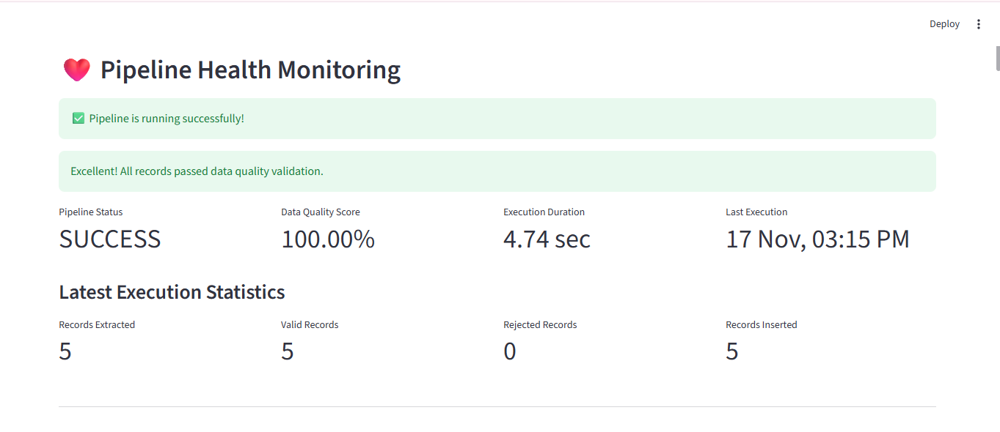
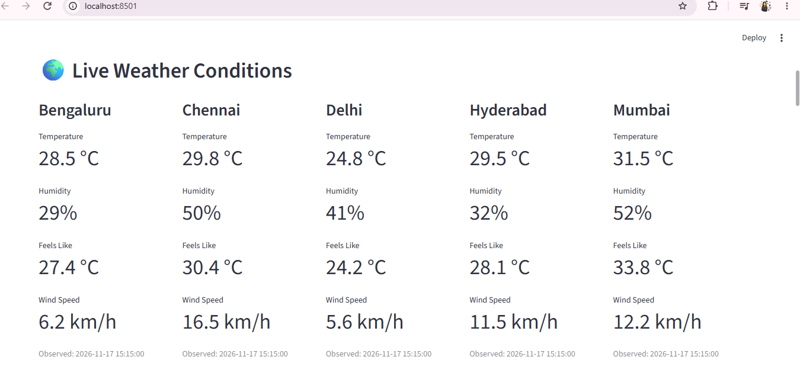
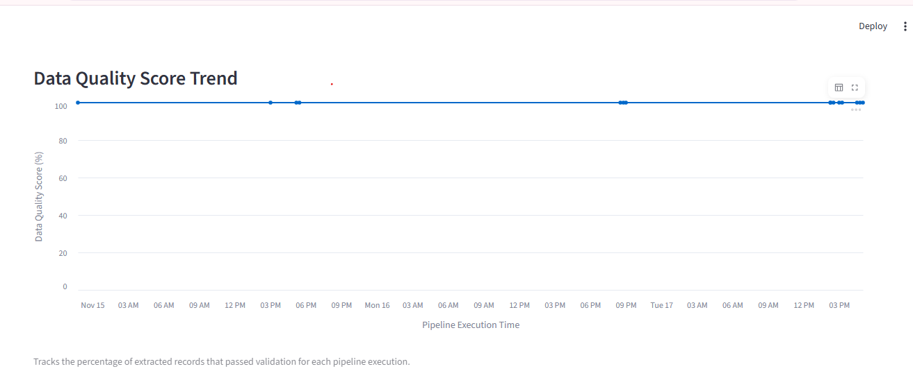
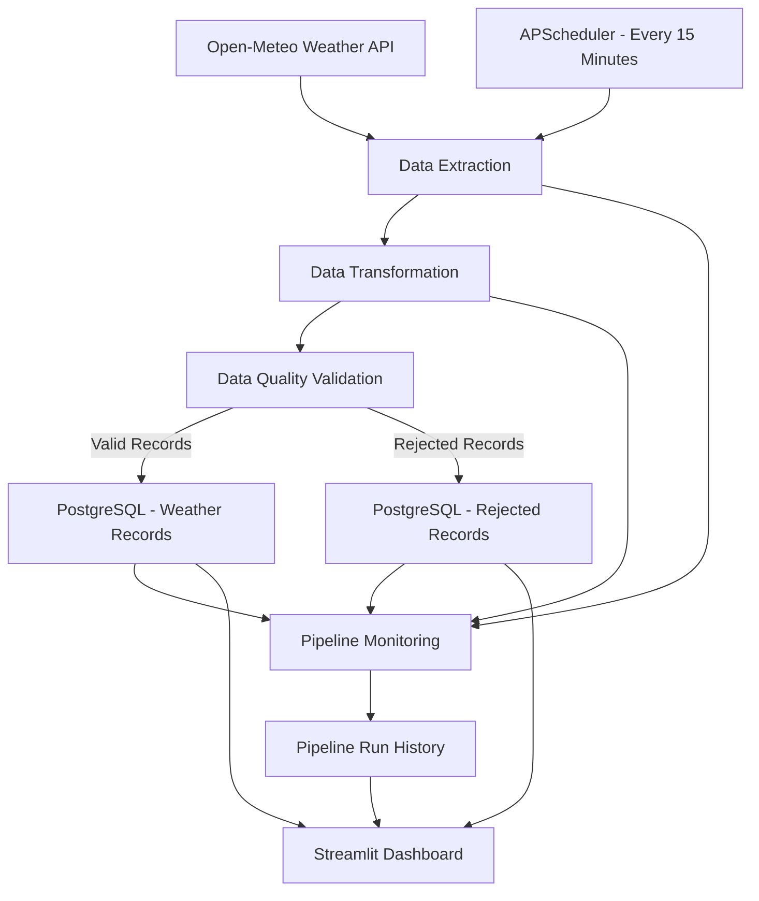

# 🌦️ Real-Time Weather Data Engineering & Quality Monitoring Pipeline

An end-to-end data engineering project that automatically collects weather data from multiple Indian cities, validates incoming records, stores structured data in PostgreSQL, and monitors pipeline execution and data quality through an interactive Streamlit dashboard.

The pipeline integrates API-based data ingestion, data transformation, validation, database loading, automated scheduling, and real-time monitoring to demonstrate a practical data engineering workflow.

## 🎯 Project Objective

To build a reliable and automated weather data pipeline that:

- Extracts weather information from multiple cities using a public API.
- Validates incoming records and identifies data quality issues.
- Loads valid records into PostgreSQL.
- Stores rejected records for monitoring and analysis.
- Tracks pipeline execution performance and data quality.
- Displays weather insights and pipeline health through a Streamlit dashboard.


## 🛠️ Technology Stack

| Category | Technologies |
|---|---|
| Programming Language | Python |
| Data Extraction | Open-Meteo REST API, Requests |
| Data Processing | Pandas |
| Database | PostgreSQL |
| Database Integration | SQLAlchemy, Psycopg |
| Data Validation | Python, Pandas |
| Scheduling | APScheduler |
| Dashboard | Streamlit |
| Configuration | Python-dotenv |
| Logging | Python Logging |
| Testing | Pytest |

## ✨ Key Features

- **Multi-City Weather Ingestion:** Collects weather data for Chennai, Bengaluru, Mumbai, Delhi, and Hyderabad.
- **Automated Pipeline Execution:** Runs automatically every 15 minutes using APScheduler.
- **Data Quality Validation:** Checks incoming weather records and separates valid and rejected data.
- **Duplicate Prevention:** Uses database constraints and conflict handling to avoid duplicate city observations.
- **PostgreSQL Storage:** Stores weather observations, rejected records, and pipeline execution history.
- **Pipeline Monitoring:** Tracks execution status, duration, extracted records, inserted records, and quality scores.
- **Interactive Dashboard:** Displays live weather conditions, historical analytics, rejected records, and pipeline health.
- **Logging and Error Handling:** Records pipeline activities and errors for troubleshooting.
- **Automated Startup:** Uses Windows Task Scheduler to start the pipeline after Windows sign-in.


## 📊 Dashboard Preview

The Streamlit dashboard provides a centralized view of weather conditions, data quality, and pipeline execution performance.

### 1. Pipeline Health


### 2. Live Weather Conditions


### 3. Historical Weather Analytics


### 4. Data Quality Monitoring


### 5. Data Quality Score Trend



## 🚀 Installation & Setup

### Prerequisites

Make sure you have installed:

- Python 3.9 or later
- PostgreSQL
- Git
- Visual Studio Code (recommended)

### 1. Clone the Repository

```bash
git clone YOUR_GITHUB_REPOSITORY_URL
cd real-time-data-engineering-pipeline
```

### 2. Create a Virtual Environment

```bash
python -m venv venv
```

Activate it on Windows PowerShell:

```powershell
.\venv\Scripts\Activate.ps1
```

### 3. Install Dependencies

```bash
pip install -r requirements.txt
```

### 4. Configure Environment Variables

Create a `.env` file in the project root directory.

Add your PostgreSQL connection details:

```env
DB_HOST=localhost
DB_PORT=5432
DB_NAME=weather_pipeline
DB_USER=postgres
DB_PASSWORD=your_postgresql_password
```

Replace the password placeholder with your own local PostgreSQL password.

**Important:** Never upload your `.env` file or database password to GitHub.

### 5. Run the Pipeline

Execute a single pipeline run:

```bash
python main.py
```

### 6. Launch the Streamlit Dashboard

```bash
python -m streamlit run dashboard/app.py
```

Open the local dashboard URL displayed in your terminal.

### 7. Start Automated Scheduling

```bash
python scheduler.py
```

The scheduler executes the pipeline immediately on startup and then runs it every 15 minutes.


## 🏗️ System Architecture

The pipeline follows an automated Extract, Transform, Load (ETL) architecture.



### 🔄 Data Pipeline Workflow

1. **Extraction:** Fetch weather observations from the Open-Meteo API for five Indian cities.
2. **Transformation:** Convert the extracted data into structured Pandas DataFrames.
3. **Validation:** Check records for data quality issues and separate valid and rejected records.
4. **Loading:** Store valid weather observations and rejected records in PostgreSQL.
5. **Monitoring:** Record execution status, duration, record counts, and data quality scores.
6. **Visualization:** Present weather information and pipeline performance through Streamlit.
7. **Scheduling:** APScheduler automatically triggers pipeline executions every 15 minutes.


## 🗄️ Database Design

The project uses PostgreSQL to maintain weather observations, rejected records, and pipeline execution history.

### 1. weather_records

Stores validated weather observations collected from the five cities.

| Column | Description |
|---|---|
| id | Unique record identifier |
| city | City name |
| latitude | Geographic latitude |
| longitude | Geographic longitude |
| observation_time | Weather observation timestamp |
| temperature_2m | Temperature at 2 metres |
| relative_humidity_2m | Relative humidity |
| apparent_temperature | Feels-like temperature |
| precipitation | Precipitation measurement |
| weather_code | Weather condition code |
| wind_speed_10m | Wind speed at 10 metres |
| created_at | Record creation timestamp |

**Constraint:** A unique constraint on `(city, observation_time)` prevents duplicate observations.

### 2. rejected_weather_records

Stores weather records that fail data quality validation, along with their rejection reasons.

### 3. pipeline_runs

Maintains pipeline execution history and performance metrics.

| Column | Description |
|---|---|
| id | Unique pipeline run identifier |
| started_at | Execution start time |
| finished_at | Execution completion time |
| execution_duration_seconds | Total execution duration |
| records_extracted | Total records extracted |
| records_valid | Records passing validation |
| records_rejected | Records failing validation |
| records_inserted | Records inserted into PostgreSQL |
| data_quality_score | Percentage of valid records |
| status | SUCCESS or FAILED |
| error_message | Execution error details, if any |
| created_at | Monitoring record creation timestamp |


## 📈 Sample SQL Analytics

The following queries demonstrate how weather observations and pipeline performance can be analysed using PostgreSQL.

### 1. Latest Weather Observation for Each City

```sql
SELECT DISTINCT ON (city)
    city,
    observation_time,
    temperature_2m,
    relative_humidity_2m,
    precipitation,
    wind_speed_10m
FROM weather_records
ORDER BY city, observation_time DESC;
```

### 2. Average Temperature by City

```sql
SELECT
    city,
    ROUND(AVG(temperature_2m)::numeric, 2) AS average_temperature
FROM weather_records
GROUP BY city
ORDER BY average_temperature DESC;
```

### 3. Pipeline Execution Summary

```sql
SELECT
    status,
    COUNT(*) AS total_runs,
    ROUND(AVG(execution_duration_seconds)::numeric, 2)
        AS average_duration_seconds
FROM pipeline_runs
GROUP BY status;
```

### 4. Data Quality Score by Execution

```sql
SELECT
    id,
    started_at,
    data_quality_score,
    records_extracted,
    records_valid,
    records_rejected
FROM pipeline_runs
ORDER BY started_at DESC;
```

### 5. Rejected Records Summary

```sql
SELECT
    rejection_reason,
    COUNT(*) AS total_rejected
FROM rejected_weather_records
GROUP BY rejection_reason
ORDER BY total_rejected DESC;
```


## 🧪 Testing & Reliability

The project uses automated testing with Pytest to verify important pipeline functionality.

### Testing Coverage

- Data extraction and API response handling.
- Data transformation and validation.
- Separation of valid and rejected records.
- Database loading and duplicate prevention.
- Pipeline monitoring and execution tracking.

### Run Tests

Activate your virtual environment and execute:

```bash
pytest -v
```

### Reliability Features

- API retry mechanism with three attempts.
- Error handling for failed city-level API requests.
- Duplicate prevention using PostgreSQL constraints.
- Logging of pipeline execution events and errors.
- Automated execution monitoring.
- Data quality score calculation.
- Scheduled execution with APScheduler.


### Latest Test Results

All 9 automated tests passed successfully.

| Metric | Result |
|---|---:|
| Total Tests | 9 |
| Passed | 9 |
| Failed | 0 |
| Execution Time | 1.07 seconds |

Test execution command:

```bash
python -m pytest -v
```

<escape>**Test Status:** All tests passed successfully.</escape>


## 📁 Project Structure

```text


real-time-data-engineering-pipeline/
│
├── config/
│   └── config.py
│
├── dashboard/
│   ├── app.py
│   └── app - Copy.py  (local backup; not for GitHub)
│
├── src/
│   ├── __init__.py
│   ├── database.py
│   ├── extract.py
│   ├── load.py
│   ├── logger.py
│   ├── monitoring.py
│   ├── scheduler.py
│   └── transform.py
│
├── tests/
│   ├── test_extract_retries.py
│   ├── test_load.py
│   ├── test_rejected_record.py
│   └── test_transform.py
│
├── screenshots/
│   ├── pipeline_health.png
│   ├── live_weather.png
│   ├── historical_analytics.png
│   ├── data_quality_monitoring.png
│   └── data_quality_score_trend.png
│
├── data/
├── logs/
├── sql/
├── main.py
├── scheduler.py
├── run_scheduler.bat
├── requirements.txt
├── .gitignore
└── README.md


```
