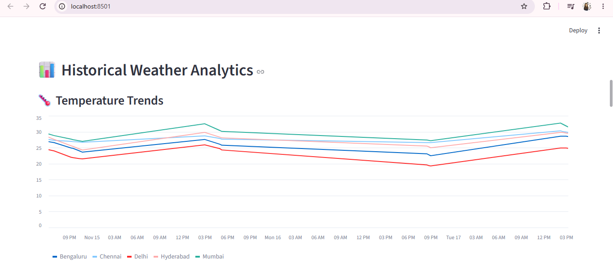
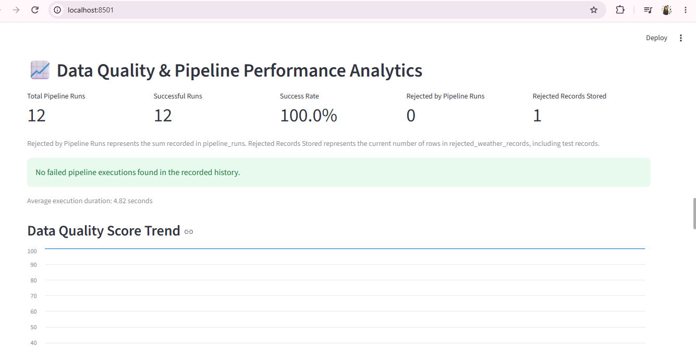
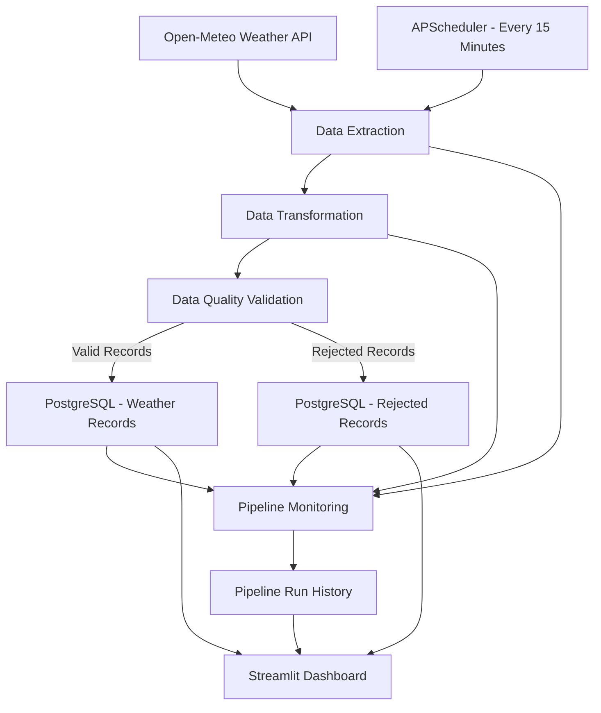

# 🌦️ Real-Time Weather Data Engineering & Quality Monitoring Pipeline

[](https://github.com/uthrathirulok/real-time-weather-data-engineering-pipeline/actions/workflows/ci.yml)

An end-to-end data engineering project that automatically collects weather data from multiple Indian cities, validates incoming records, stores structured data in PostgreSQL, and monitors pipeline execution and data quality through an interactive Streamlit dashboard.

The pipeline integrates API-based data ingestion, data transformation, validation, database loading, automated scheduling, and monitoring to demonstrate a practical data engineering workflow.

## 🎯 Project Objective

To build a reliable and automated weather data pipeline that:

- Extracts weather information from multiple cities using a public API.
- Validates incoming records and identifies data quality issues.
- Loads valid records into PostgreSQL.
- Stores rejected records for monitoring and analysis.
- Tracks pipeline execution performance and data quality.
- Displays weather insights and pipeline health through a Streamlit dashboard.

## 🛠️ Technology Stack

| Category | Technologies |
|---|---|
| Programming Language | Python |
| Data Extraction | Open-Meteo REST API, Requests |
| Data Processing | Pandas |
| Database | PostgreSQL |
| Database Integration | SQLAlchemy, Psycopg |
| Data Validation | Python, Pandas |
| Scheduling | APScheduler |
| Dashboard | Streamlit |
| Configuration | Python-dotenv |
| Logging | Python Logging |
| Testing | Pytest |

## ✨ Key Features

- **Multi-City Weather Ingestion:** Collects weather data for Chennai, Bengaluru, Mumbai, Delhi, and Hyderabad.
- **Automated Pipeline Execution:** Runs automatically every 15 minutes using APScheduler.
- **Data Quality Validation:** Checks incoming weather records and separates valid and rejected data.
- **Duplicate Prevention:** Uses database constraints and conflict handling to avoid duplicate city observations.
- **PostgreSQL Storage:** Stores weather observations, rejected records, and pipeline execution history.
- **Pipeline Monitoring:** Tracks execution status, duration, extracted records, inserted records, and quality scores.
- **Pipeline Failure Alerting:** Detects consecutive pipeline failures, identifies critical failure conditions, displays error messages, and detects pipeline recovery through dashboard alerts.
- **Interactive Dashboard:** Displays weather conditions, historical analytics, rejected records, and pipeline health.
- **Logging and Error Handling:** Records pipeline activities and errors for troubleshooting.
- **Automated Startup:** Uses Windows Task Scheduler to start the pipeline after Windows sign-in.

## 📊 Dashboard Preview

The Streamlit dashboard provides a centralized view of weather conditions, data quality, and pipeline execution performance.

### 1. Pipeline Health


### 2. Live Weather Conditions


### 3. Historical Weather Analytics



### 4. Data Quality Monitoring



### 5. Data Quality Score Trend


## 🚀 Installation & Setup

### Prerequisites

Make sure the following tools are installed:

- Python 3.9 or later
- PostgreSQL
- Git
- Visual Studio Code (recommended)

### 1. Clone the Repository

```bash
git clone https://github.com/uthrathirulok/real-time-weather-data-engineering-pipeline.git

cd real-time-weather-data-engineering-pipeline
```

### 2. Create and Activate a Virtual Environment

```bash
python -m venv venv
```

For Windows PowerShell:

```powershell
.\venv\Scripts\Activate.ps1
```

### 3. Install Dependencies

```bash
pip install -r requirements.txt
```

### 4. Set Up the PostgreSQL Database

1. Make sure PostgreSQL is running.
2. Open pgAdmin 4.
3. Create a database named `weather_pipeline`.
4. Select the database and open Tools → Query Tool.
5. Open the project's `sql/schema.sql` file.
6. Execute the SQL script.

The script creates three tables:

- `weather_records` – stores validated weather observations.
- `rejected_weather_records` – stores rejected records and their reasons.
- `pipeline_runs` – stores pipeline execution history and monitoring metrics.

### 5. Configure Environment Variables

Create a `.env` file in the project root directory.

Add your PostgreSQL connection details:

```env
DB_HOST=localhost
DB_PORT=5432
DB_NAME=weather_pipeline
DB_USER=postgres
DB_PASSWORD=your_postgresql_password
```

Replace the password placeholder with your own PostgreSQL password.

**Important:** Never upload your `.env` file or database credentials to GitHub.

### 6. Run the Pipeline

Execute:

```bash
python main.py
```

The pipeline extracts weather data, validates records, loads valid and rejected records into PostgreSQL, and records execution details.

### 7. Launch the Streamlit Dashboard

```bash
python -m streamlit run dashboard/app.py
```

Open the local dashboard URL displayed in your terminal.

### 8. Start Automated Scheduling

```bash
python scheduler.py
```

The scheduler executes the pipeline immediately on startup and then runs it every 15 minutes.

## 🏗️ System Architecture

The pipeline follows an automated Extract, Transform, Load (ETL) architecture.



### 🔄 Data Pipeline Workflow

1. **Extraction:** Fetch weather observations from the Open-Meteo API for five Indian cities.
2. **Transformation:** Convert extracted data into structured Pandas DataFrames.
3. **Validation:** Check records for data quality issues and separate valid and rejected records.
4. **Loading:** Store valid weather observations and rejected records in PostgreSQL.
5. **Monitoring:** Record execution status, duration, record counts, and data quality scores.
6. **Visualization:** Present weather information and pipeline performance through Streamlit.
7. **Scheduling:** APScheduler automatically triggers pipeline executions every 15 minutes.

## 🗄️ Database Design

The project uses PostgreSQL to maintain weather observations, rejected records, and pipeline execution history.

### 1. weather_records

Stores validated weather observations collected from the five cities.

| Column | Description |
|---|---|
| id | Unique record identifier |
| city | City name |
| latitude | Geographic latitude |
| longitude | Geographic longitude |
| observation_time | Weather observation timestamp |
| temperature_2m | Temperature at 2 metres |
| relative_humidity_2m | Relative humidity |
| apparent_temperature | Feels-like temperature |
| precipitation | Precipitation measurement |
| weather_code | Weather condition code |
| wind_speed_10m | Wind speed at 10 metres |
| created_at | Record creation timestamp |

**Constraint:** A unique constraint on `(city, observation_time)` prevents duplicate observations.

### 2. rejected_weather_records

Stores weather records that fail data quality validation, along with their rejection reasons.

| Column | Description |
|---|---|
| id | Unique rejected record identifier |
| city | City name |
| latitude | Geographic latitude |
| longitude | Geographic longitude |
| observation_time | Weather observation timestamp |
| temperature_2m | Temperature at 2 metres |
| relative_humidity_2m | Relative humidity |
| apparent_temperature | Feels-like temperature |
| precipitation | Precipitation measurement |
| weather_code | Weather condition code |
| wind_speed_10m | Wind speed at 10 metres |
| rejection_reason | Reason the record failed validation |
| rejected_at | Rejection timestamp |

### 3. pipeline_runs

Maintains pipeline execution history and performance metrics.

| Column | Description |
|---|---|
| id | Unique pipeline run identifier |
| started_at | Execution start time |
| finished_at | Execution completion time |
| execution_duration_seconds | Total execution duration |
| records_extracted | Total records extracted |
| records_valid | Records passing validation |
| records_rejected | Records failing validation |
| records_inserted | Records inserted into PostgreSQL |
| data_quality_score | Percentage of valid records |
| status | SUCCESS, PARTIAL, or FAILED |
| error_message | Execution error details, if any |
| created_at | Monitoring record creation timestamp |

## Data Quality Validation

The pipeline applies data validation during the transformation stage to ensure that only valid weather records are loaded into the main PostgreSQL table.

### Validation Rules

| Field | Validation Rule |
|---|---|
| City | Must be a non-empty string |
| Latitude | Must be between -90 and 90 |
| Longitude | Must be between -180 and 180 |
| Observation Time | Must be a valid, non-empty timestamp |
| Temperature | Must be between -80°C and 60°C |
| Relative Humidity | Must be between 0% and 100% |
| Apparent Temperature | Must be between -100°C and 70°C |
| Precipitation | Must be between 0 and 1000 mm |
| Weather Code | Must be between 0 and 99 |
| Wind Speed | Must be between 0 and 400 km/h |

Numeric fields are converted to numeric values. Missing, non-numeric, non-finite, and out-of-range values are rejected.

### Duplicate Detection

- Identifies duplicate records using the combination of city and observation time.
- Removes duplicate combinations before separating valid and rejected records.
- Keeps the last occurrence in the input data.
- Records with invalid city or observation-time keys are not included in duplicate detection.

### Rejected Records

Records that fail validation are excluded from the main `weather_records` table and stored in the `rejected_weather_records` table with their rejection reasons.

### Data Quality Score

The data quality score measures the percentage of valid records after duplicate removal.

**Formula:**

Data Quality Score = (Valid Records / Records After Duplicate Removal) × 100

For example, if 8 records are valid and 2 are rejected, the data quality score is 80%.

If no records remain after duplicate removal, the score is 0%.

The score is logged during transformation and recorded as part of pipeline execution monitoring.

## 📈 Sample SQL Analytics

The following queries demonstrate how weather observations and pipeline performance can be analysed using PostgreSQL.

### 1. Latest Weather Observation for Each City

```sql
SELECT DISTINCT ON (city)
    city,
    observation_time,
    temperature_2m,
    relative_humidity_2m,
    precipitation,
    wind_speed_10m
FROM weather_records
ORDER BY city, observation_time DESC;
```

### 2. Average Temperature by City

```sql
SELECT
    city,
    ROUND(AVG(temperature_2m)::numeric, 2) AS average_temperature
FROM weather_records
GROUP BY city
ORDER BY average_temperature DESC;
```

### 3. Pipeline Execution Summary

```sql
SELECT
    status,
    COUNT(*) AS total_runs,
    ROUND(AVG(execution_duration_seconds)::numeric, 2)
        AS average_duration_seconds
FROM pipeline_runs
GROUP BY status;
```

### 4. Data Quality Score by Execution

The following SQL query retrieves the data quality score and record statistics for each pipeline execution.

```sql
SELECT
    id,
    started_at,
    data_quality_score,
    records_extracted,
    records_valid,
    records_rejected
FROM pipeline_runs
ORDER BY started_at DESC;
```

### 5. Rejected Records Summary

```sql
SELECT
    rejection_reason,
    COUNT(*) AS total_rejected
FROM rejected_weather_records
GROUP BY rejection_reason
ORDER BY total_rejected DESC;
```

## 🧪 Testing & Reliability

The project uses **Pytest** to verify the reliability of its extraction, transformation, database, loading, monitoring, and logging components.

### Test Coverage

The automated test suite contains **87 tests across eight test modules**.

| Test Module | Tests | Coverage |
|---|---:|---|
| `test_database.py` | 10 | Database configuration, engine creation, and connection handling |
| `test_extract_retries.py` | 8 | API retries, failed requests, and malformed responses |
| `test_load.py` | 10 | Database loading, duplicate handling, and rejected records |
| `test_logger.py` | 4 | Rotating file logging, console logging, and handler management |
| `test_main.py` | 7 | Pipeline success, partial execution, and failure handling |
| `test_monitoring.py` | 10 | Pipeline execution monitoring, database error handling, and failure alert evaluation |
| `test_scheduler.py` | 2 | Automated scheduler behavior |
| `test_transform.py` | 36 | Data validation, missing values, duplicates, numeric boundaries, and invalid values |
| **Total** | **87** | |

### Run Tests Locally

Activate the virtual environment and execute:

```bash
python -m pytest -v
```

### Latest Test Results

The latest verified automated test execution completed successfully.

| Metric | Result |
|---|---:|
| Total Tests | 87 |
| Passed | 87 |
| Failed | 0 |
| Execution Time | 5.67 seconds |

**Test Status:** All 87 automated tests passed successfully.

### Reliability Features

- API retry mechanism with up to three attempts.
- Error handling for failed city-level API requests.
- Data validation and rejection of invalid records.
- Duplicate prevention using PostgreSQL unique constraints.
- Database transaction handling during record loading.
- Logging of pipeline execution events and errors.
- Automated pipeline execution monitoring.
- Data quality score calculation.
- Scheduled execution using APScheduler.
- Dashboard-based failure alerting with consecutive failure tracking, critical alerts, error visibility, and recovery detection.

## 📁 Project Structure

```text
real-time-weather-data-engineering-pipeline/
│
├── config/
│   └── config.py
│
├── dashboard/
│   └── app.py
│
├── sql/
│   └── schema.sql
│
├── src/
│   ├── __init__.py
│   ├── database.py
│   ├── extract.py
│   ├── load.py
│   ├── logger.py
│   ├── monitoring.py
│   ├── scheduler.py
│   └── transform.py
│
├── tests/
│   ├── test_database.py
│   ├── test_extract_retries.py
│   ├── test_load.py
│   ├── test_logger.py
│   ├── test_main.py
    │── test_monitoring.py
    ├── test_scheduler.py
    └── test_transform.py
│
├── screenshots/
│   ├── pipeline_health.png
│   ├── live_weather.png
│   ├── historical_analytics.png
│   ├── data_quality_monitoring.png
│   └── data_quality_score_trend.png
│
├── main.py
├── scheduler.py
├── simulate_rejected_record.py
├── run_scheduler.bat
├── requirements.txt
├── .gitignore
└── README.md
```

## 🐳 Docker Deployment

The pipeline is containerized using Docker, with PostgreSQL running in a separate container. Docker Compose manages both services and their communication.

### Architecture

- **Pipeline Container:** Runs the Python ETL application.
- **PostgreSQL Container:** Stores weather records, rejected records, and pipeline execution metrics.
- **Docker Compose:** Orchestrates the application and database services.
- **Persistent Storage:** Uses a Docker named volume to retain database data across container restarts.

### Docker Services

| Service | Description | Port |
|---|---|---|
| pipeline | Python ETL application | — |
| db | PostgreSQL database | 5433 (host) / 5432 (container) |

### Run with Docker

**1. Build the Docker image**

```bash
docker compose build pipeline
```

**2. Start PostgreSQL**

```bash
docker compose up -d db
```

**3. Initialize the database schema**

```powershell
Get-Content -Raw sql/schema.sql | docker compose exec -T db sh -c 'psql -U "$POSTGRES_USER" -d "$POSTGRES_DB"'
```

**4. Run the ETL pipeline**

```bash
docker compose up --force-recreate pipeline
```

**5. Verify the loaded records**

```bash
docker compose exec -T db psql -U postgres -d weather_pipeline -t -A -c "SELECT COUNT(*) FROM weather_records;"
```

**6. Verify pipeline monitoring**

```bash
docker compose exec -T db psql -U postgres -d weather_pipeline -t -A -c "SELECT id, status, records_extracted, records_valid, records_inserted, data_quality_score FROM pipeline_runs;"
```

### Data Persistence

PostgreSQL data is stored in a Docker named volume (`weather_db_data`), allowing database records to persist when containers are stopped or recreated.


### Automated Database Backup & Recovery

The project includes an automated PostgreSQL backup system to protect pipeline data and support database recovery.

#### Backup Features

- Automated daily backups scheduled using Windows Task Scheduler.
- PostgreSQL backups created using `pg_dump` in custom archive format.
- Archive validation using `pg_restore`.
- SHA-256 checksum verification to confirm backup integrity.
- Backup files stored locally in the `backups/` directory.
- Checksum files generated alongside each backup.
- Temporary backup files inside the Docker container are cleaned up after execution.
- Backup automation implemented in Python.

#### Backup Schedule

| Setting | Value |
|---|---|
| Frequency | Daily |
| Scheduled Time | 9:00 AM |
| Scheduler | Windows Task Scheduler |
| Backup Format | PostgreSQL Custom (`-Fc`) |
| Validation | `pg_restore -l` |
| Integrity Verification | SHA-256 |

#### Backup Location

```text
backups/
├── weather_pipeline_<timestamp>.dump
└── weather_pipeline_<timestamp>.sha256
```

The local `backups/` directory is excluded from Git to prevent database backup files from being uploaded to the repository.

#### Backup Script

The automated backup process is implemented in:

```text
scripts/backup_database.py
```

The script performs the following steps:

1. Creates a PostgreSQL database dump inside the Docker container.
2. Validates the backup archive.
3. Copies the backup to the local Windows backup directory.
4. Compares SHA-256 checksums between the container backup and local copy.
5. Saves the checksum in a separate `.sha256` file.
6. Cleans up temporary container backup files.
7. Reports backup success or failure.

#### Recovery Testing

Backup recovery was tested by restoring the archive into a separate test database.

- Restored database tables successfully.
- Verified restored record counts.
- Confirmed the original production database remained untouched.

This verifies that the backup archive can be restored and that the recovery process works without affecting the live database.


### Stop Docker Services

```bash
docker compose down
```

> Note: `docker compose down` stops and removes containers and the network, but preserves the database volume. Database data remains available when the services are started again.

## 👩‍💻 Author

**Uthra Thirulogasundar**

- **GitHub:** [uthrathirulok](https://github.com/uthrathirulok)
- **Project Repository:** [Real-Time Weather Data Engineering & Quality Monitoring Pipeline](https://github.com/uthrathirulok/real-time-weather-data-engineering-pipeline)